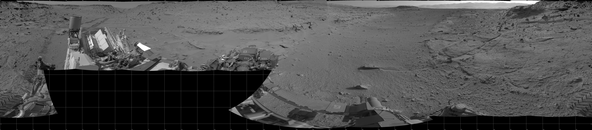

# Journey to the Mars

How would you get from a landing site to an observation point on Mars? We built *Journey to the Mars* to explore that question for the 2026 NASA Space Apps Challenge. Our interactive map brings together NASA terrain, imagery and scientific observations. You can inspect a steep stretch in Jezero Crater, compare detours or plan a trip between points you choose. Our GPS-free positioning prototype, **Mountain Tracker**, compares the skyline in front of an observer with horizons predicted from the terrain.

**[Open the interactive Mars map](https://atlasforcn.github.io/NASA-SPACE-APPS-2026/)** · [Read the Space Apps submission](https://www.spaceappschallenge.org/2026/find-a-team/seal-and-friends1/?tab=project) · [Explore the 50 resources cited in our submission](SUBMISSION-REFERENCES.md)

## Background

For our seventh Space Apps Challenge, our team, Seal and Friends, imagined a teammate about to land on Mars. Which slopes would they have to cross? What could they learn about the rocks at their destination? If they lost track of their position, could the mountains on the horizon help them find it again?

Google Maps inspired the route planner. Satellite star trackers and *The Legend of Zelda: Breath of the Wild* inspired Mountain Tracker. We drew on research into drone navigation and planetary rover localization to test whether the outline of a ridge could help identify a camera position in an orbital elevation map.

## Demo walkthrough

The demo opens in English. You can also follow this walkthrough in the [Traditional Chinese edition](https://atlasforcn.github.io/NASA-SPACE-APPS-2026/zh/).

### Jezero Science Mission

1. Choose **Jezero Science Mission** on the opening screen. Find the base and observation site A. Before checking the route, look at the straight line between them and pick the stretch you think will be hardest to cross.
2. Select **Check the route from the base to A**, then **Show the assessed segment on the map**. The highlighted segment and elevation profile show where the straight line exceeds the mission’s slope limit.
3. Select **Find and compare detours**. Compare the distance and maximum slope for each alternative. Then open **Layers** and select **Spectral**. The base and site A share one olivine-abundance cell, more than 10 km across, even though the terrain profile changes sharply between them.

### Free Exploration

Choose **Switch modes**, then **Free Exploration**. Open the **Mission** tab, select **Set starting point on the map** and click a location. Select **Add destination on the map** and click a second location. Select **Build and evaluate three routes** to compare the shortest, lower-risk and lowest-estimated-energy options. Switch between their elevation profiles to see where the paths diverge. You can add stops, adjust the terrain-risk and energy assumptions, or mark a circular exclusion zone and replan. The GeoJSON export records the itinerary, assumptions and sources.

### Where am I?

- **Try a simulated skyline.** In the Jezero mission, open the skyline exercise on the base-to-A route. In Free Exploration, build a route and open the exercise from its elevation profile. The orange line shows the simulated view from a hidden point. The dashed cyan line shows the predicted view from the spot you picked. Submit your guess to see the distance between the two positions.
- **Try a real panorama.** We traced the ridgeline in Curiosity’s Dingo Gap panorama by hand. The demo replays a match calculated in advance. Pick the peak you trust most, then reveal NASA’s recorded camera position to see how far our top candidate landed from it. [Open the Dingo Gap replay](https://atlasforcn.github.io/NASA-SPACE-APPS-2026/#dingo-gap)
- **Try your own photo.** On the mission selection screen, choose the photo matcher below the Curiosity panorama. Upload an image or trace a skyline, check the outline, set the projection, field of view and camera pitch, then search the loaded terrain. An approximate starting point narrows the search. The result is a set of candidate positions. Measuring the error requires an independently known camera position. [Open the photo matcher](https://atlasforcn.github.io/NASA-SPACE-APPS-2026/#photo-matcher)



*Curiosity’s left navigation camera, sols 538–539, Gale Crater. Image courtesy of NASA/JPL-Caltech.* [Original panorama](https://science.nasa.gov/resource/sol-0539-left-navigation-camera-cylindrical-projection/)

## How it works

### Route planning

The Vue and Leaflet app uses A* to search a digital elevation model (DEM). Each route respects the slope and roughness limits, elevation coverage and any user-marked exclusion zones. The shortest route minimizes terrain distance. The lower-risk route accounts for slope, roughness and surface material. The energy model estimates relative travel costs along each segment using grade and material factors.

Multi-stop and return-trip planning draw on MOMAR. Walking time uses Tobler’s hiking function, scaled to the chosen level-ground speed, plus time at stops. You can compare estimated walking times for all three routes. The model uses terrestrial walking data and adjustable energy assumptions. [MOMAR route planner](https://www.momar.si/planner/) · [Tobler’s technical report](https://escholarship.org/uc/item/05r820mz)

### Maps and observations

The global map combines Viking optical imagery with Mars Orbiter Laser Altimeter (MOLA) elevations. Regional terrain and orthorectified imagery support closer inspection. In Jezero, USGS geological units show which mapped surfaces a route crosses.

| Region | Terrain used by the app |
| --- | --- |
| Jezero Crater | 30 × 30 km of Context Camera (CTX) terrain, sampled at 40 m |
| Gale Crater | 10 × 10 km of merged terrain, sampled at 20 m from a native 1 m grid |
| Valles Marineris | 20 × 20 km of CTX stereo terrain, sampled at 40 m |
| Global Mars | MOLA at about 3.7 km per cell at the equator. Regional sampling starts at 4 km and coarsens for larger areas. |

Four global science layers show TES thermal inertia and olivine abundance, GMM-3 gravity anomalies and Odyssey GRS iron concentration. The map also marks 2,055 official place names and ten sample-tube deposits at Three Forks. MEDA pressure and RAD absorbed-dose measurements appear at their historical stations. A map hint flags historical temperature readings at Jezero or Gale and radiation readings at Gale when they exceed thresholds set by the user. These station records describe conditions at the time and place of measurement. [Data sources, processing and resolution](docs/SOURCES.md)

### Mountain Tracker

Mountain Tracker uses color and brightness rules to propose a boundary between sky and terrain. Clouds, shadows and rover hardware can interrupt that boundary, so you can correct it by hand. For each candidate position and heading, the tracker predicts a horizon from the DEM and ranks matches by the difference between the observed and predicted outlines. Uploaded images are processed in the browser. A separate landmark-bearing exercise uses simulated bearings to known peaks to estimate position and heading.

## What we measured

In the Jezero scenario, one stretch of the 5.52 km straight line reaches **27.4°**, above the **15°** limit we set. Both detours pass the terrain checks. The shorter detour covers **5.84 km** with a maximum modeled slope of **8.8°**. The gentler detour covers **6.52 km** and reduces the maximum slope to **5.4°**, at the cost of about **680 m** of extra walking.

We also tested three Curiosity panoramas against recorded rover positions. The table gives the distance from the top-ranked candidate to NASA’s position when the terrain search considered ridges up to 90 km from the observer.

| Curiosity panorama | Role in the experiment | Position error |
| --- | --- | ---: |
| Sol 38 | Method development | 1,449 m |
| Sol 535 | Blind test after fixing the method | 5,699 m |
| Sols 538–539, Dingo Gap | Additional case, replayed in the demo | 815 m |

At Dingo Gap the skyline residual was **0.378°**, above the **0.20°** threshold for automatic correction. The demo therefore presents a candidate position. [Photo validation report and Perseverance candidate records](docs/PHOTO-VALIDATION.md)

## What we want to try next

We want to collect more Mars photographs with independently known camera positions and test whether machine learning improves ridgeline extraction, particularly in cloudy scenes. We would reserve entire locations for evaluation and compare both methods against the recorded positions. The same experiment could be tried in a small area on the Moon or another world where both the terrain and camera positions are well documented.

## Data and research references

The submission lists 25 NASA resources and 25 partner or other resources. The register links each source to its use in the project. The research references below cover our positioning and route-planning methods and the scientific products behind the map. [Submission resource register](SUBMISSION-REFERENCES.md)

<details>
<summary>Research bibliography (11 works)</summary>

**Positioning and route planning**

- Ebadi K, Coble K, Kogan D, Atha D, Schwartz R, Padgett C, et al. Toward autonomous localization of planetary robotic explorers by relying on semantic mapping. In: 2022 IEEE Aerospace Conference (AERO). IEEE; 2022. p. 1–10. [doi:10.1109/AERO53065.2022.9843550](<https://doi.org/10.1109/AERO53065.2022.9843550>)
- Liu WH. Automatic mountain peak recognition by curve matching [master’s thesis, in Chinese]. Chung Yuan Christian University; 2013. [National Central Library record](<https://ndltd.ncl.edu.tw/cgi-bin/gs32/gsweb.cgi?o=dnclcdr&s=id%3D%22101CYCU5392021%22.&searchmode=basic>)
- Tobler W. Three presentations on geographical analysis and modeling. National Center for Geographic Information and Analysis, University of California, Santa Barbara; 1993. Technical Report 93-1. [University of California repository](<https://escholarship.org/uc/item/05r820mz>)
- Zou LH, Lin CH. Deep learning-based image feature matching for UAV visual positioning. Journal of Photogrammetry and Remote Sensing. 2024;29(4):211–230. [doi:10.6574/JPRS.202412_29(4).0002](<https://doi.org/10.6574/JPRS.202412_29(4).0002>)

**Mars terrain and scientific observations**

- Bandfield JL. Global mineral distributions on Mars. Journal of Geophysical Research: Planets. 2002;107(E6):5042. [doi:10.1029/2001JE001510](<https://doi.org/10.1029/2001JE001510>)
- Bell JF 3rd, Maki JN, Alwmark S, Ehlmann BL, Fagents SA, Grotzinger JP, et al. Geological, multispectral, and meteorological imaging results from the Mars 2020 Perseverance rover in Jezero crater. Science Advances. 2022;8(47):eabo4856. [doi:10.1126/sciadv.abo4856](<https://doi.org/10.1126/sciadv.abo4856>)
- Boynton WV, Taylor GJ, Evans LG, Reedy RC, Starr R, Janes DM, et al. Concentration of H, Si, Cl, K, Fe, and Th in the low- and mid-latitude regions of Mars. Journal of Geophysical Research: Planets. 2007;112(E12):E12S99. [doi:10.1029/2007JE002887](<https://doi.org/10.1029/2007JE002887>)
- Christensen PR, Moore HJ. The Martian surface layer. In: Kieffer HH, Jakosky BM, Snyder CW, Matthews MS, editors. Mars. University of Arizona Press; 1992. p. 686–729. [NASA Technical Reports Server](<https://ntrs.nasa.gov/citations/19930043876>)
- Genova A, Goossens S, Lemoine FG, Mazarico E, Neumann GA, Smith DE, et al. Seasonal and static gravity field of Mars from MGS, Mars Odyssey and MRO radio science. Icarus. 2016;272:228–245. [doi:10.1016/j.icarus.2016.02.050](<https://doi.org/10.1016/j.icarus.2016.02.050>)
- Sun VZ, Stack KM. Geologic map of Jezero crater and the Nili Planum region, Mars. U.S. Geological Survey; 2020. Scientific Investigations Map 3464. Scale 1:75,000. [doi:10.3133/sim3464](<https://doi.org/10.3133/sim3464>)
- Vasavada AR, Grotzinger JP, Arvidson RE, Calef FJ, Crisp JA, Gupta S, et al. Overview of the Mars Science Laboratory mission: Bradbury Landing to Yellowknife Bay and beyond. Journal of Geophysical Research: Planets. 2014;119(6):1134–1161. [doi:10.1002/2014JE004622](<https://doi.org/10.1002/2014JE004622>)

</details>

## Development and validation records

### Running locally

Use Node.js 22.12 or later and npm. CI uses Node.js 24. Install dependencies and start the development server.

```sh
npm ci
npm run dev
```

In a second terminal, run the tests and preview the production build.

```sh
npm test
npx playwright install chromium
npm run test:pages
npm run build
npm run preview
```

The built app is static and can be served from `dist/`. The approximately 33 MB global elevation grid loads on demand. The Pages suite exercises root and project-subpath builds, route planning, positioning, Mars place data, DEM download retries, date-line crossings, polar terrain and mobile layouts. Browser screenshots go to `test-results/`. The dedicated planner check is `node tests/planner-browser.mjs`. It defaults to Edge on Windows and accepts a browser path through `BROWSER_EXECUTABLE`.

### Reproducing a scenario

- **Route assumptions.** The defaults are 3 km/h on level ground, 15 minutes per stop, an eight-hour budget, a 10° steep-slope flag and a 15° slope limit. Roughness uses a 0–1 scale and defaults to a limit of 1. These are adjustable simulation settings. The DEM cannot resolve wheel- or foot-scale hazards.
- **Surface costs.** The Jezero scenario applies an energy multiplier of 1.8 to aeolian unit 7, 1.25 to units 9–13, 1.0 to other known units and 1.1 to unknown material. An optional TES adjustment uses the native eight-pixels-per-degree grid. By default it applies a factor of 1.2 below 200 J m⁻² K⁻¹ s⁻½. Where both factors apply, the planner uses the larger one. Displaying a layer and enabling its route cost are separate controls.
- **Image geometry.** Perspective images support a horizontal field of view of 10–150° and equirectangular panoramas 10–360°. Use the field of view after cropping and correct lens distortion and camera roll. The simulated drive uses the same DEM to generate and match skylines. By default it checks at the start and every 250 m in Jezero. On global MOLA terrain it reports experimental candidates every 4 km and retains the odometry estimate.
- **Global coverage.** When a route extends beyond the initial 512 × 512 km MOLA window, the app rebuilds the grid around its points. Larger areas use coarser cells, and the local projection limits the accuracy of long-distance bearings and distances.

### Repository and deployment

| Location | Contents |
| --- | --- |
| `src/`, `core.mjs`, `planet.mjs`, `skyline.mjs` | Vue interface, shared terrain and routing functions, and skyline matching |
| `data/` | Terrain, imagery, mission records, source labels and science grids |
| `docs/` | [Source notes](docs/SOURCES.md), [photo tests](docs/PHOTO-VALIDATION.md) and the [Leaflet license](docs/Leaflet-LICENSE.txt) |
| `scripts/`, `tests/` | Data preparation, asset verification and regression tests |

Run `python3 scripts/prepare-science.py` to rebuild the science layers with the required Python packages. Use `node scripts/export-regions.mjs` to export regional grids from MOLA. The web app itself runs entirely in the browser. After changing a data asset, review its classification in `static-assets.json` and run `npm run assets:update`. The build checks file paths, case, sizes, published hashes and links in the built HTML and CSS.

The public demo linked above is hosted on Atlas GitHub Pages. This repository also has its own GitHub Actions workflow. It verifies pushes and pull requests and deploys successful default-branch builds with a root base path for the configured custom domain. To reproduce the project-subpath test locally, set `PAGES_BASE_PATH=/nasa2026/` for the build and preview, then open that path. [Pages workflow](.github/workflows/pages.yml)

For a release to the configured custom domain, `mars.chuan.one`, verify the Pages domain setting, DNS records and HTTPS certificate. From a fresh browser session, load the terrain and imagery, add and remove destinations and exclusion zones, and plan a short route around a marked zone. Record the URL, test date and result.
